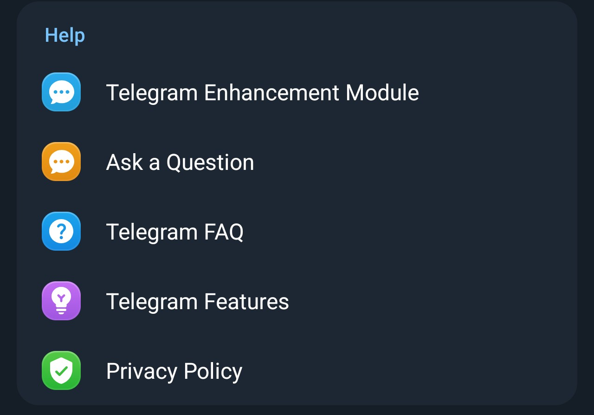
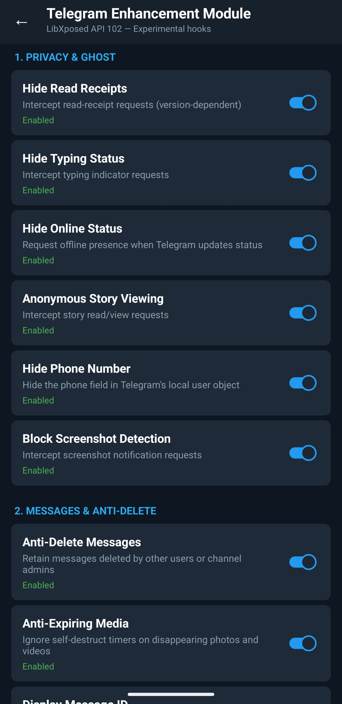

# TelegramPatcher

An Xposed module for Telegram (libxposed API 102). Configure it in **Telegram → Settings → Help → Telegram Enhancement Module**.

**Tested:** Telegram 13.1.1, Android 17.

## Features

- **Privacy:** hide read receipts, typing, online status, story views, phone number (local only) and screenshot notifications.
- **Messages:** anti-delete, expiring-media controls, silent sends and `; ID` at the end of text messages.
- **Media:** disable `FLAG_SECURE`, save restricted stories/content, treat voice notes as audio and bypass client-side forwarding limits.
- **Interface:** hide stories bar, disable channel swipe, show exact counts and local Premium appearance (no paid subscription).
- **Network:** download concurrency, hide promo dialogs and suppress update checks.
- **Translation:** keyless Google Translate, batched requests and Telegram fallback. Text is sent to Google.
- **Controls:** individual toggles, logging switch and signature/DexKit hook resolution.

## Screenshots

